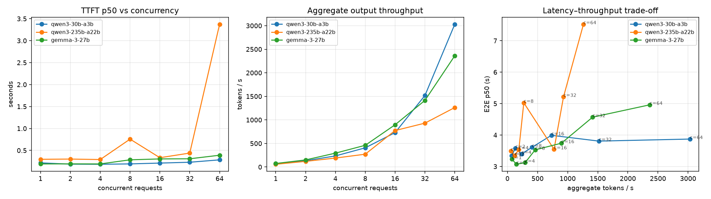

# tokenbench

**Pick the right open-source LLM for a workload — with numbers.**

`tokenbench` measures latency, throughput, quality and cost of LLMs served behind any
OpenAI-compatible API — [Nebius Token Factory](https://tokenfactory.nebius.com), a self-hosted
vLLM / SGLang server, or anything else that speaks `/v1/chat/completions` — and turns the
results into a report a customer could make a decision from.

It answers the questions that come up in almost every LLM proof-of-concept:

| Question | Experiment | Command |
|---|---|---|
| How fast is it for one user, and how does it hold up under load? | Concurrency sweep: TTFT, TPOT, E2E p50/p99, aggregate tokens/s | `tokenbench loadtest` |
| Is the small model *good enough* for my task? | Code-scored evals: math reasoning, JSON extraction, classification | `tokenbench eval` |
| Does reusing a long system prompt make it faster? | Prefix-cache A/B: shared vs cache-busted prefix | `tokenbench cache` |
| Can I save money by sending easy requests to a small model? | Rule-based router + offline replay on eval results | `tokenbench route-eval`, `tokenbench router` |
| What do KV cache, batching and precision do *inside* the model? | Local PyTorch/Transformers benchmark | `python local/hf_inference_bench.py` |

## Quick start

```bash
git clone https://github.com/jo1-yo/tokenbench && cd tokenbench
make install            # uv venv + editable install
make test               # runs everything against a built-in mock server, no key needed
```

Against Nebius Token Factory:

```bash
export NEBIUS_API_KEY=...                            # console → API keys
.venv/bin/tokenbench models -c configs/nebius.yaml   # which model ids are live
# edit configs/nebius.yaml: models to compare, prices ($/1M tokens), router small/large
make bench                                           # → runs/nebius/REPORT.md + charts
```

Offline (no key, no cost):

```bash
make mock     # terminal 1: fake OpenAI-compatible server
make demo     # terminal 2: full pipeline → runs/mock-demo/REPORT.md
```

## Results: Nebius Token Factory, November 2026

Three models on the shared serverless endpoint, `configs/nebius.yaml`:

| model | architecture | price in / out ($ per 1M tokens) |
|---|---|---|
| `Qwen/Qwen3-30B-A3B-Instruct-2507` | MoE, 30B total / 3B active | 0.10 / 0.30 |
| `Qwen/Qwen3-235B-A22B-Instruct-2507` | MoE, 235B total / 22B active | 0.20 / 0.60 |
| `google/gemma-3-27b-it` | dense, 27B | 0.10 / 0.30 |

Two full runs on 2026-11-12, about 15 minutes apart. Run 1 swept concurrency 1–16 and run 2
swept 1–64. Each run cost a few cents. Full reports are in
[`docs/results/REPORT-run1.md`](docs/results/REPORT-run1.md) and
[`docs/results/REPORT-run2.md`](docs/results/REPORT-run2.md).



**Load (run 2)**

| model | c | TTFT p50 | TTFT p99 | TPOT p50 | aggregate tok/s | per-request tok/s | errors |
|---|---|---|---|---|---|---|---|
| qwen3-30b-a3b | 1 | 0.22 s | 0.28 s | 13.7 ms | 69 | 75 | 0/16 |
| qwen3-30b-a3b | 32 | 0.23 s | 0.50 s | 15.2 ms | 1518 | 67 | 0/64 |
| qwen3-30b-a3b | 64 | 0.29 s | 0.61 s | 14.9 ms | **3031** | 68 | 0/128 |
| qwen3-235b-a22b | 1 | 0.30 s | 1.03 s | 15.1 ms | 57 | 71 | 0/16 |
| qwen3-235b-a22b | 32 | 0.44 s | 2.46 s | 21.8 ms | 931 | 47 | 0/64 |
| qwen3-235b-a22b | 64 | **3.37 s** | 6.47 s | 20.7 ms | 1262 | 50 | **4/128** (HTTP 529 "worker overloaded") |
| gemma-3-27b | 1 | 0.19 s | 0.36 s | 11.9 ms | 74 | 81 | 0/16 |
| gemma-3-27b | 32 | 0.31 s | 0.55 s | 17.1 ms | 1414 | 57 | 0/64 |
| gemma-3-27b | 64 | 0.39 s | 1.07 s | 18.3 ms | 2363 | 51 | 1/128 (HTTP 502) |

**Quality, cache and routing (both runs agree)**

| | qwen3-30b-a3b | qwen3-235b-a22b | gemma-3-27b |
|---|---|---|---|
| eval accuracy (47 items) | 97.9% | 100% | 97.9% |
| eval cost | $0.0013 | $0.0025 | $0.0013 |
| prefix-cache TTFT speedup, run 1 / run 2 | 1.19× / 1.18× | 1.09× / 0.85× | 1.70× / 1.80× |
| cached tokens reported (of ~2.4k) | 2368 | 2368 | 2408 |

| routing policy | accuracy | cost | sent to large |
|---|---|---|---|
| always small (30B) | 97.9% | $0.0013 | 0% |
| always large (235B) | 100% | $0.0025 | 100% |
| routed | 97.9% | $0.0021 | 40% |

### What I take from it

1. **The small MoE is the default.** Qwen3-30B-A3B missed one item out of 47, a support-ticket
   classification. It costs half as much as the 235B model and, with only 3B parameters active per
   token, held flat per-request speed (around 68 tok/s) and sub-second p99 TTFT all the way to 64
   concurrent requests. Aggregate throughput roughly doubled with every doubling of concurrency,
   so I never reached its knee on this endpoint.
2. **The 235B model hits its knee between 32 and 64 concurrent requests.** At 64, median TTFT
   jumped from 0.44 s to 3.4 s and the endpoint started returning `529 worker overloaded`. A
   workload with more than about 50 simultaneous users on this model should get dedicated
   capacity rather than the shared endpoint.
3. **Gemma degrades smoothly instead of hitting a wall.** Per-request speed fell from 81 to 51 tok/s
   between 1 and 64 concurrent requests, with no queueing spike. That is the usual batching
   curve: more requests share each decode step, so each one gets a smaller slice.
4. **Prefix caching works. How much it helps depends on the model and on the load.** The endpoint
   reported cache hits on about 2.4k prompt tokens for all three models. Gemma's TTFT dropped
   1.7–1.8× in both runs. Qwen gained under 1.2×, and for the 235B model in run 2, queueing noise
   was bigger than the saving. The practical rule still holds: put the static part of the prompt
   first.
5. **Routing doesn't pay on these tasks.** It saves 16% against always-large, but always-small is
   cheaper still and just as accurate. The eval set is too easy to separate the models, so the
   next step is harder items, not a smarter router.
6. **One run is not a result on a shared endpoint.** Run 1 showed the 235B model decoding faster
   than the 30B (8.8 ms vs 15.5 ms per token) and Gemma at 16 tok/s at concurrency 1. Neither
   result came back in run 2, which points to a quiet server and a cold start, not to the models.
   Everything above is stated only where both runs agree, or it is marked as run 2.

## What gets measured, and why

**Latency is two different numbers.** A streaming response has a *prefill* phase (the model reads
the whole prompt and produces the first token) and a *decode* phase (one token at a time).

- **TTFT** — time to first token. What makes a chatbot feel responsive. Grows with prompt length
  and queueing.
- **TPOT** — time per output token after the first. What makes long answers feel slow. Grows with
  model size and with how many requests the server batches together.
- **E2E** ≈ TTFT + TPOT × (output tokens − 1).

`client.py` measures all three from the stream itself and reads token counts from the
`usage` chunk (`stream_options={"include_usage": true}`).

**Throughput vs latency is a trade-off, not a number.** The load test is closed-loop: at
concurrency *C* there are always *C* requests in flight. As *C* grows, the server batches more
requests per decode step, so *aggregate* tokens/s goes up while each individual request gets
slower. The third chart in the report (E2E vs aggregate tokens/s) shows where that curve bends —
the knee is the operating point you'd size a deployment around. Percentiles (p50/p99) are
reported because tail latency, not the average, is what users complain about.

**Quality is task-specific.** Public leaderboards don't tell you whether an 8B model can extract
your fields. The evals are small, hand-written and scored by code (exact numeric match,
per-field JSON match, label match), so a run is cheap and reproducible:

| task | n | scoring |
|---|---|---|
| math | 20 | multi-step word problems; final `Answer: <number>` must match |
| extraction | 12 | free text → JSON with 5 fields, scored per field |
| classification | 15 | support ticket → one of 5 intents |

**Prefix caching.** Engines like vLLM split the prompt into blocks and keep the KV cache of
blocks they've seen, keyed by a hash of the block *and everything before it*. So a long system
prompt shared by every request only needs to be prefilled once. `tokenbench cache` sends the
same ~2.8k-token system prompt repeatedly, interleaved with a variant that has a random id at the
very start (same length, but no prefix can ever match), and compares TTFT. If the provider
reports `usage.prompt_tokens_details.cached_tokens`, that is recorded too. Practical takeaway
for customers: put the static part of the prompt first and the variable part last.

**Routing.** `router.py` is a transparent rule-based router: structured tasks (classification,
extraction) go to the small model; prompts with signals of multi-step reasoning, math or code go
to the large one. Two ways to use it:

- `tokenbench route-eval runs/<run>` replays an existing eval run under three policies
  (always-small, always-large, routed) and reports accuracy, latency and cost of each — without
  spending extra tokens.
- `tokenbench router` serves it as an OpenAI-compatible proxy (FastAPI). Any OpenAI SDK client can
  point its `base_url` at it; the chosen model and the reason come back in `x-routed-model` /
  `x-route-reason` headers, and `x-tier: large` forces a tier. The `Dockerfile` packages it.

**Inside the model (local).** `local/hf_inference_bench.py` loads a small model
(Qwen2.5-0.5B-Instruct by default) with PyTorch + Transformers on CUDA, Apple Silicon or CPU and
measures, with everything else held fixed:

- generation with the KV cache on vs off,
- aggregate tokens/s at batch size 1, 4 and 8 (left-padded batched generation),
- half precision vs float32: weight memory and speed.

```bash
uv pip install -e ".[local]"
.venv/bin/python local/hf_inference_bench.py
```

## Project layout

```
tokenbench/
  client.py       one timed streaming request (TTFT / TPOT / E2E / tokens / cached tokens)
  metrics.py      percentiles and run summaries
  loadtest.py     closed-loop concurrency sweep
  evals.py        tasks, prompts, code-based scorers, runner
  cache_exp.py    prefix-cache A/B experiment
  router.py       choose_tier(), OpenAI-compatible routing proxy, offline route replay
  report.py       charts (matplotlib) + REPORT.md
  mock_server.py  fake OpenAI-compatible server with a realistic latency shape (tests/CI)
  cli.py          `tokenbench ...`
configs/          nebius.yaml, vllm-local.yaml, mock.yaml
data/             load-test prompts and eval sets (jsonl)
local/            PyTorch/Transformers in-process benchmark
tests/            unit tests + full pipeline against the mock server
```

## The mock server

`tokenbench mock` is not a model — it returns filler text, so eval accuracy against it is 0%. It
imitates the *latency shape* of a real server so the whole pipeline can be tested offline and in
CI: prefill cost proportional to prompt length, block-level prefix caching, and decode steps
that slow down as more requests are batched together.

## Limitations

- Closed-loop load only; real traffic arrives open-loop (Poisson), which produces worse tails at
  the same average load.
- Serverless endpoints are shared: results depend on time of day and other tenants. Run more than
  once before drawing conclusions.
- Eval sets are small (47 items) — good for spotting large gaps between models, not for
  separating models a few points apart.
- The router is rules, not a learned classifier. A natural next step is to train a small
  classifier on which items the small model actually gets wrong.

## License

MIT
