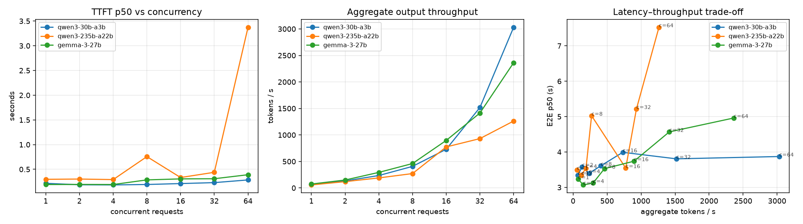
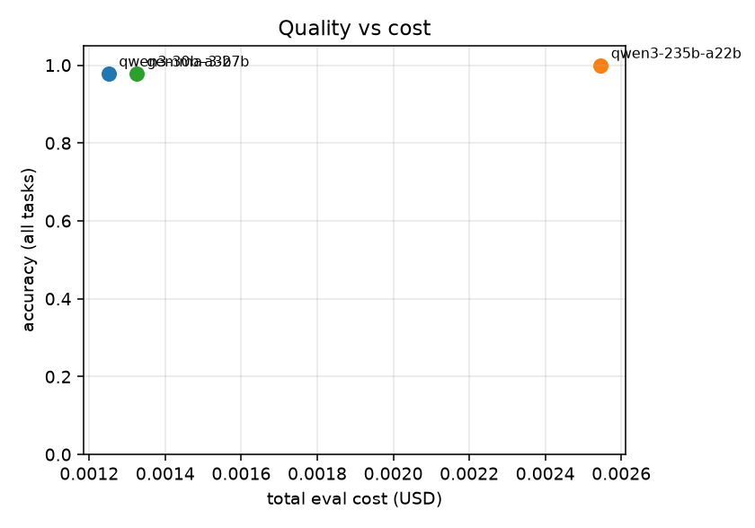

# tokenbench report — `nebius`

## Load test

| model | conc. | TTFT p50 | TTFT p99 | TPOT p50 | E2E p50 | agg tok/s | per-req tok/s | errors | $/1k req |
|---|---|---|---|---|---|---|---|---|---|
| qwen3-30b-a3b | 1 | 0.189 | 0.359 | 0.0155 | 3.731 | 62 | 65.9 | 0/16 | 0.061 |
| qwen3-30b-a3b | 2 | 0.209 | 0.388 | 0.0166 | 3.934 | 108 | 61.9 | 0/16 | 0.062 |
| qwen3-30b-a3b | 4 | 0.226 | 0.541 | 0.0159 | 3.862 | 212 | 64.4 | 0/16 | 0.060 |
| qwen3-30b-a3b | 8 | 0.281 | 0.431 | 0.0157 | 3.959 | 359 | 66.3 | 0/16 | 0.061 |
| qwen3-30b-a3b | 16 | 0.204 | 0.528 | 0.0155 | 4.058 | 699 | 63.5 | 0/32 | 0.061 |
| qwen3-235b-a22b | 1 | 0.211 | 0.453 | 0.0088 | 2.179 | 96 | 113.5 | 0/16 | 0.125 |
| qwen3-235b-a22b | 2 | 0.241 | 0.632 | 0.0098 | 2.437 | 170 | 103.2 | 0/16 | 0.125 |
| qwen3-235b-a22b | 4 | 0.361 | 11.111 | 0.0173 | 4.137 | 109 | 58.0 | 0/16 | 0.123 |
| qwen3-235b-a22b | 8 | 0.327 | 1.168 | 0.0154 | 3.225 | 340 | 67.9 | 0/16 | 0.125 |
| qwen3-235b-a22b | 16 | 0.330 | 0.762 | 0.0163 | 4.155 | 670 | 67.4 | 0/32 | 0.124 |
| gemma-3-27b | 1 | 0.475 | 1.011 | 0.0630 | 16.683 | 16 | 32.2 | 0/16 | 0.070 |
| gemma-3-27b | 2 | 0.204 | 0.464 | 0.0119 | 3.286 | 146 | 81.4 | 0/16 | 0.070 |
| gemma-3-27b | 4 | 0.195 | 7.635 | 0.0118 | 3.235 | 153 | 70.1 | 0/16 | 0.070 |
| gemma-3-27b | 8 | 0.328 | 0.513 | 0.0167 | 4.433 | 368 | 57.2 | 0/16 | 0.070 |
| gemma-3-27b | 16 | 0.391 | 0.589 | 0.0158 | 4.408 | 796 | 65.4 | 0/32 | 0.070 |

## Quality evals

| model | task | n | accuracy | mean latency (s) | mean out tokens | cost (USD) | errors |
|---|---|---|---|---|---|---|---|
| qwen3-30b-a3b | math | 20 | 100.0% | 2.59 | 121 | 0.0009 | 0 |
| qwen3-30b-a3b | extraction | 12 | 100.0% | 0.93 | 40 | 0.0003 | 0 |
| qwen3-30b-a3b | classification | 15 | 93.3% | 0.25 | 3 | 0.0001 | 0 |
| qwen3-30b-a3b | all | 47 | 97.9% | 1.42 | 63 | 0.0012 | 0 |
| qwen3-235b-a22b | math | 20 | 100.0% | 1.64 | 122 | 0.0018 | 0 |
| qwen3-235b-a22b | extraction | 12 | 100.0% | 0.89 | 50 | 0.0006 | 0 |
| qwen3-235b-a22b | classification | 15 | 100.0% | 0.37 | 3 | 0.0002 | 0 |
| qwen3-235b-a22b | all | 47 | 100.0% | 1.04 | 65 | 0.0025 | 0 |
| gemma-3-27b | math | 20 | 100.0% | 5.52 | 118 | 0.0009 | 0 |
| gemma-3-27b | extraction | 12 | 100.0% | 4.93 | 66 | 0.0004 | 0 |
| gemma-3-27b | classification | 15 | 93.3% | 0.62 | 4 | 0.0001 | 0 |
| gemma-3-27b | all | 47 | 97.9% | 3.80 | 68 | 0.0013 | 0 |

## Routing (replayed on the eval run)

| policy | accuracy | mean latency (s) | cost (USD) | % sent to large |
|---|---|---|---|---|
| always_small | 97.9% | 1.42 | 0.0012 | 0% |
| always_large | 100.0% | 1.04 | 0.0025 | 100% |
| routed | 97.9% | 1.02 | 0.0021 | 40% |

## Prefix caching

| model | prompt tokens | TTFT shared prefix | TTFT busted prefix | speedup | cached tokens (shared / busted) |
|---|---|---|---|---|---|
| qwen3-30b-a3b | 2429 | 0.281 | 0.333 | 1.19x | 2368 / – |
| qwen3-235b-a22b | 2427 | 0.627 | 0.684 | 1.09x | 2368 / – |
| gemma-3-27b | 2462 | 0.242 | 0.410 | 1.70x | 2408 / – |
