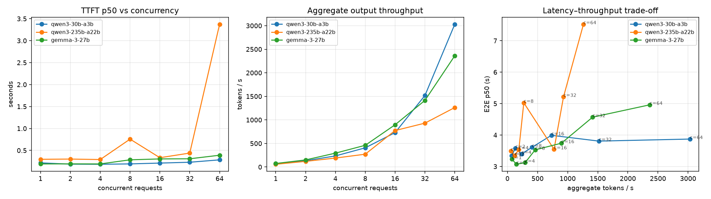
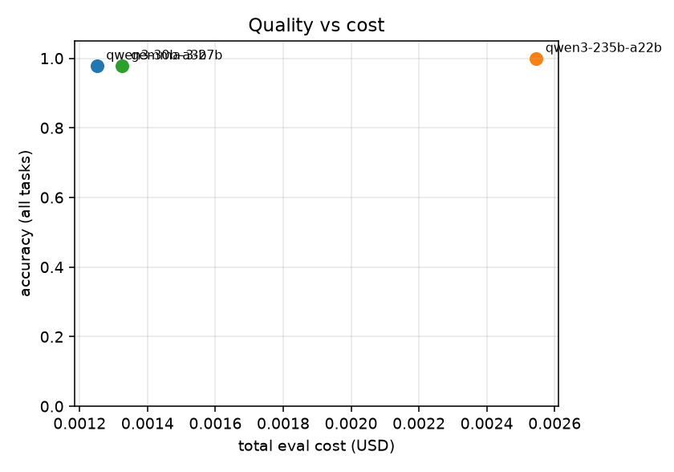

# tokenbench report — `nebius-c64`

## Load test

| model | conc. | TTFT p50 | TTFT p99 | TPOT p50 | E2E p50 | agg tok/s | per-req tok/s | errors | $/1k req |
|---|---|---|---|---|---|---|---|---|---|
| qwen3-30b-a3b | 1 | 0.216 | 0.282 | 0.0137 | 3.347 | 69 | 74.6 | 0/16 | 0.062 |
| qwen3-30b-a3b | 2 | 0.187 | 0.342 | 0.0135 | 3.582 | 133 | 73.1 | 0/16 | 0.062 |
| qwen3-30b-a3b | 4 | 0.184 | 0.354 | 0.0140 | 3.399 | 235 | 71.4 | 0/16 | 0.062 |
| qwen3-30b-a3b | 8 | 0.193 | 0.443 | 0.0136 | 3.608 | 407 | 74.0 | 0/16 | 0.062 |
| qwen3-30b-a3b | 16 | 0.211 | 0.447 | 0.0153 | 3.991 | 730 | 64.2 | 0/32 | 0.061 |
| qwen3-30b-a3b | 32 | 0.231 | 0.502 | 0.0152 | 3.807 | 1518 | 67.1 | 0/64 | 0.061 |
| qwen3-30b-a3b | 64 | 0.285 | 0.610 | 0.0149 | 3.872 | 3031 | 67.5 | 0/128 | 0.062 |
| qwen3-235b-a22b | 1 | 0.298 | 1.025 | 0.0151 | 3.492 | 57 | 71.1 | 0/16 | 0.123 |
| qwen3-235b-a22b | 2 | 0.303 | 1.000 | 0.0131 | 3.346 | 120 | 76.4 | 0/16 | 0.125 |
| qwen3-235b-a22b | 4 | 0.292 | 0.769 | 0.0177 | 3.541 | 189 | 62.6 | 0/16 | 0.124 |
| qwen3-235b-a22b | 8 | 0.757 | 1.360 | 0.0226 | 5.026 | 272 | 46.0 | 0/16 | 0.124 |
| qwen3-235b-a22b | 16 | 0.334 | 0.774 | 0.0146 | 3.545 | 774 | 70.0 | 0/32 | 0.125 |
| qwen3-235b-a22b | 32 | 0.439 | 2.458 | 0.0218 | 5.215 | 931 | 47.1 | 0/64 | 0.124 |
| qwen3-235b-a22b | 64 | 3.374 | 6.465 | 0.0207 | 7.525 | 1262 | 50.4 | 4/128 | 0.125 |
| gemma-3-27b | 1 | 0.192 | 0.362 | 0.0119 | 3.232 | 74 | 81.2 | 0/16 | 0.070 |
| gemma-3-27b | 2 | 0.194 | 0.510 | 0.0112 | 3.070 | 150 | 87.0 | 0/16 | 0.070 |
| gemma-3-27b | 4 | 0.192 | 0.365 | 0.0113 | 3.122 | 294 | 87.6 | 0/16 | 0.071 |
| gemma-3-27b | 8 | 0.286 | 0.586 | 0.0130 | 3.529 | 461 | 76.4 | 0/16 | 0.070 |
| gemma-3-27b | 16 | 0.306 | 0.534 | 0.0144 | 3.741 | 897 | 71.1 | 0/32 | 0.070 |
| gemma-3-27b | 32 | 0.309 | 0.553 | 0.0171 | 4.568 | 1414 | 57.0 | 0/64 | 0.070 |
| gemma-3-27b | 64 | 0.390 | 1.074 | 0.0183 | 4.961 | 2363 | 50.8 | 1/128 | 0.070 |

## Quality evals

| model | task | n | accuracy | mean latency (s) | mean out tokens | cost (USD) | errors |
|---|---|---|---|---|---|---|---|
| qwen3-30b-a3b | math | 20 | 100.0% | 2.09 | 124 | 0.0009 | 0 |
| qwen3-30b-a3b | extraction | 12 | 100.0% | 0.85 | 40 | 0.0003 | 0 |
| qwen3-30b-a3b | classification | 15 | 93.3% | 0.24 | 3 | 0.0001 | 0 |
| qwen3-30b-a3b | all | 47 | 97.9% | 1.18 | 64 | 0.0013 | 0 |
| qwen3-235b-a22b | math | 20 | 100.0% | 2.00 | 122 | 0.0018 | 0 |
| qwen3-235b-a22b | extraction | 12 | 100.0% | 0.84 | 50 | 0.0006 | 0 |
| qwen3-235b-a22b | classification | 15 | 100.0% | 0.95 | 3 | 0.0002 | 0 |
| qwen3-235b-a22b | all | 47 | 100.0% | 1.37 | 65 | 0.0025 | 0 |
| gemma-3-27b | math | 20 | 100.0% | 1.76 | 116 | 0.0008 | 0 |
| gemma-3-27b | extraction | 12 | 100.0% | 1.33 | 66 | 0.0004 | 0 |
| gemma-3-27b | classification | 15 | 93.3% | 0.31 | 4 | 0.0001 | 0 |
| gemma-3-27b | all | 47 | 97.9% | 1.19 | 68 | 0.0013 | 0 |

## Routing (replayed on the eval run)

| policy | accuracy | mean latency (s) | cost (USD) | % sent to large |
|---|---|---|---|---|
| always_small | 97.9% | 1.18 | 0.0013 | 0% |
| always_large | 100.0% | 1.37 | 0.0025 | 100% |
| routed | 97.9% | 1.15 | 0.0021 | 40% |

## Prefix caching

| model | prompt tokens | TTFT shared prefix | TTFT busted prefix | speedup | cached tokens (shared / busted) |
|---|---|---|---|---|---|
| qwen3-30b-a3b | 2425 | 0.324 | 0.382 | 1.18x | 2368 / – |
| qwen3-235b-a22b | 2427 | 1.443 | 1.222 | 0.85x | 2368 / – |
| gemma-3-27b | 2465 | 0.384 | 0.689 | 1.80x | 2408 / – |
